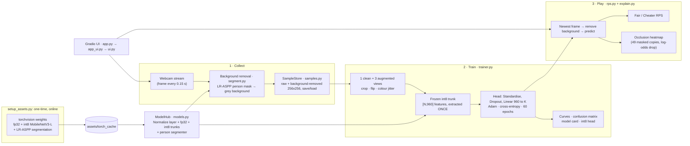

# Teach Me in 60s: the complete project explanation

> This document explains **everything** about the project: what it is, how every part works, the exact numbers we measured, how it was tested, what it does *not* do, and an honest self-assessment. It is self-contained, so a teammate, examiner or reviewer can read it without the code.
> The short "how do I run it" guide is in `README.md`.

---

## Contents
1. [One-paragraph summary](#1-one-paragraph-summary)
2. [The assignment and how we meet it](#2-the-assignment-and-how-we-meet-it)
3. [Big picture and architecture](#3-big-picture-and-architecture)
4. [The backbone: MobileNetV3-Large (fp32 and int8)](#4-the-backbone-mobilenetv3-large-fp32-and-int8)
5. [The game in full detail](#5-the-game-in-full-detail)
6. [Syllabus coverage, module by module](#6-syllabus-coverage-module-by-module)
7. [Engineering: code structure and design decisions](#7-engineering-code-structure-and-design-decisions)
8. [Offline and CPU-only strategy](#8-offline-and-cpu-only-strategy)
9. [Testing and verification](#9-testing-and-verification)
10. [Every number we measured](#10-every-number-we-measured)
11. [Development log: decisions, problems and fixes](#11-development-log-decisions-problems-and-fixes)
12. [Limitations and honest caveats](#12-limitations-and-honest-caveats)
13. [Evaluation guide and self-assessment (rating)](#13-evaluation-guide-and-self-assessment-rating)
14. [Glossary](#14-glossary)

---

## 1. One-paragraph summary

**Teach Me in 60s** is a Gradio web app in which players teach an AI their own hand gestures and then play Rock-Paper-Scissors against it.

Players show the webcam ✊ Rock, ✋ Paper, ✌️ Scissors and "Nothing" (hands down), about 25 frames each. A **person-segmentation network removes the background** from every frame, so the AI has to look at the hand and can't learn the room. The app then **trains a classifier live in about 3 seconds on a CPU**, using **transfer learning**: a pretrained MobileNetV3-Large backbone, **int8-quantised and frozen**, turns each frame into a 960-number feature vector, and only a tiny 3,844-parameter head is trained on top. Training shows loss and accuracy curves, a confusion matrix and a model card.

In the game, a **Fair** AI throws blind and the model only referees, while a **Cheater** AI reads your hand in about 14 ms and always plays the winning move. After every round, an **occlusion-sensitivity heatmap** shows which part of the frame drove the AI's decision.

It runs fully offline after a one-time download. The code is about 2,100 lines of Python with 31 automated tests and a headless self-check. It demonstrates 8 of the 9 syllabus modules.

---

## 2. The assignment and how we meet it

**Assignment (Project 1, 10 marks, groups of up to 4):** *"Choose any concept in this course and demonstrate it in a gamified or creative manner."* The submission is a live demo in the lab with all members present. The professor's examples (object mosaics, magic eraser) were not to be copied, and originality scores better.

**Our concept:** *transfer learning*. A pretrained network can learn a new task from a handful of examples in seconds. We turned that into a game you can play against the model you just trained.

| Requirement / constraint | How the project meets it |
|---|---|
| Gamified or creative | A three-step game (collect → train → play), Rock-Paper-Scissors with two AI personalities (Fair / Cheater), a countdown, a scoreboard, and live predictions. |
| Original (not the given examples) | Not a mosaic or eraser. The twist is that players **build the opponent's brain live** and then play it, with a "cheating" AI and an explanation heatmap. |
| Demonstrates course concepts | 8 of 9 modules, each tied to something visible in the app (Section 6). |
| Live demo, all 4 members | The README has a 3-minute script with a speaking part for each member (host, data, training, play) and 15 viva Q&As. |
| Buildable in one night | No training from scratch, only pretrained weights plus a head that trains in seconds. |
| CPU-only laptop | Training ~3.3 s, a prediction ~14 ms, an explanation ~0.4 s on a laptop CPU. |
| Unreliable lab internet | `setup_assets.py` downloads ~58 MB of weights (3 models) once. The app runs offline, and we verified this with the network blocked. |
| Python + PyTorch/torchvision | PyTorch 2.14.1 and torchvision 0.29.1. |
| Simple UI (Gradio/Streamlit) | Gradio 6.30, with a Play tab and an "Under the hood" tab. |
| Webcam is a plus if reliable | Webcam streaming is the core input, with fallbacks: save/load a pre-recorded dataset, and photo upload for playing. |
| pytest smoke tests | 31 tests, all passing (~15 s). |
| Headless launch check | `python app.py --check`, plus an offline launch probe (Section 9). |
| Clean, modular, single entry point | `python app.py`; game logic is separated from the UI. |

---

## 3. Big picture and architecture



**The two tabs:**
* **✋ Play:** the whole game (collect, train, play).
* **📚 Under the hood:** the syllabus mapping, tensor shapes and experiments to try.

---

## 4. The backbone: MobileNetV3-Large (fp32 and int8)

### 4.1 Facts (from torchvision's own metadata, plus our measurements)
| | fp32 (`IMAGENET1K_V1`) | int8 (`IMAGENET1K_QNNPACK_V1`) |
|---|---|---|
| ImageNet-1k top-1 / top-5 | **74.04% / 91.34%** | **73.00% / 90.86%** |
| Parameters | 5,483,032 | 5,483,032 (stored as int8) |
| Compute | 0.217 GFLOPs per image | same ops, integer arithmetic |
| Serialised size (our measurement) | **22.1 MB** | **5.7 MB** (~3.9× smaller) |
| Single-image latency, 2 threads, Apple M2 | ~64–70 ms | **~11–14 ms** |
| Feature extraction, 304 training views | 20.9 s | **3.0 s (~7× faster)** |
| How it was made | Standard supervised training | Quantisation-aware training (QAT), then conversion |

Parameter split (fp32): **convolutional trunk (`features`) 2,971,952**, which is what we use, and the ImageNet classifier head, 2,511,080, which we throw away.

### 4.2 Architecture in one breath
MobileNetV3 stacks **inverted-residual blocks**. Each block expands the channels with a 1×1 conv, filters each channel separately with a cheap 3×3/5×5 **depthwise conv**, optionally reweights channels with **squeeze-and-excitation**, and projects back down with a 1×1 conv, with a residual connection when the shapes match. It uses **Hardswish**, a cheap approximation of swish. The design was found with neural architecture search for mobile CPUs. The trunk ends in a 1×1 conv to **960 channels at 7×7**, and global average pooling turns that into a **960-d feature vector**.

### 4.3 Tensor shapes
```
webcam frame      any size → centre square crop → 224 x 224
input             [N, 3, 224, 224]    raw pixels in [0, 1]
normalise         [N, 3, 224, 224]    (x - mean) / std, inside the model
trunk (frozen)    [N, 960, 7, 7]      int8 by default
avg-pool          [N, 960]            the feature vector we cache
head              [N, K]              Standardise → Dropout → Linear 960→K
softmax           [N, K]              class probabilities (K = 4 by default)
```

### 4.4 Normalisation as a layer
`ImageNetNormalize` (in `models.py`) is the **first layer of the model**: `(x − [0.485, 0.456, 0.406]) / [0.229, 0.224, 0.225]`. The pretrained weights expect inputs on that scale. Building it into the model means every image in the app is raw [0, 1] pixels, and normalisation can never be forgotten or applied twice. Quantised models wrap the trunk in `quant` / `dequant` stubs (float → int8 → float), which `ModelHub.embed()` handles.

### 4.5 Frozen weights and the int8 fallback
Backbone parameters have `requires_grad=False`; they are never trained here. If a laptop's PyTorch build has no quantised engine, `simulate_int8()` makes a fallback instead: weights are rounded to 8-bit integers with a **per-output-channel symmetric scale** and stored as floats. That shows the accuracy effect but not the speed-up, and the UI says which mode is active.

---

### 4.6 The segmenter (LR-ASPP MobileNetV3-Large)
A second, separate network used only for **background removal** (Section 5.2): torchvision's `lraspp_mobilenet_v3_large`, trained on COCO with the 21 Pascal VOC labels. It has 3,221,538 parameters, a 13.1 MB file and 57.9 mIoU (91.2% pixel accuracy) on COCO-val. It uses the same MobileNetV3 backbone family as the classifier, plus a lightweight "Lite R-ASPP" segmentation head, and outputs `[N, 21, H, W]` class scores per pixel. We use only channel 15, "person".

## 5. The game in full detail

### 5.1 Step 1: Collect (`ui.py`, `samples.py`)
* Classes come from a comma-separated textbox: default **Rock, Paper, Scissors, Nothing**, up to 5, deduplicated case-insensitively, 20 characters max per name.
* The webcam component **streams** a frame to the server every **0.15 s** (about 6.7 fps) once the player presses Gradio's own **● Record** button.
* One handler (`on_frame`) runs on every frame. It:
  1. stores it as the session's **latest frame** (used by the RPS countdown),
  2. while a capture is active, appends it to the selected class **together with its background-removed copy**,
  3. about 3 times per second, refreshes the **🎯 What the AI sees** preview and, once a model exists, the **live prediction** (paused during a SHOOT round, so the round gets the CPU).
* **🎞️ Capture 25 frames** grabs the next 25 frames (about 4 s). **📸 Snap 1 frame** adds one. The counters and a thumbnail gallery update live.
* Each sample is centre-cropped to a square and stored at **256×256**, slightly larger than the 224 model input, so random crops have room to move. There is a limit of **120 samples per class**.
* **Fallbacks:**
  * **💾 Save / 📂 Load** writes and reads `assets/teach_samples/<index>/<n>.jpg` (raw), `<index>/focus/<n>.jpg` (background removed) and `classes.json`. This is the demo-day safety net, tested end to end in the browser.
  * Images can be uploaded into any class.
  * You can clear one class or everything.

### 5.2 Background removal: fixing shortcut learning (`segment.py`)
**What went wrong first.** In the first real-webcam session the AI answered "scissors" for a clear ✊ (91%) and a clear ✋ (100%). The occlusion map showed why: it was **cold on the hand and hot on the room**. Between captures the camera angle changed (window, wall, curtain), so the *view of the room* predicted the class perfectly. The model learned that instead of the hand. This is **shortcut learning**. Validation still said 100%, because validation frames come from the same captures and share their backgrounds.

**The fix: semantic segmentation (Module 6).** Every frame goes through **LR-ASPP MobileNetV3-Large** (torchvision, trained on COCO with the 21 Pascal VOC classes, 3.2 M parameters, 13.1 MB, 57.9 mIoU). It gives each pixel a class; we keep the pixels it calls **"person"** (hand, arm, body) and paint everything else **flat grey**:

```
frame → centre crop 256x256 → resize 320x320 → LR-ASPP → softmax → p(person) [1, 1, 320, 320]
      → upsample to 256x256 → threshold 0.5 → mask → pixels outside the mask set to grey
```

* **Same step everywhere:** training samples, the live prediction, every SHOOT frame, the "Wrong?" corrections and the occlusion heatmap all use the background-removed view (`trainer.model_view`), so training and test inputs always match.
* **Settings were chosen on the real frames:** at 224 or 256 px the mask clipped the tips of the open-hand fingers, and 320 px with threshold 0.5 kept them (dilating the mask let in a halo of wall).
* **Cost is hidden in capture:** segmentation takes ~110 ms per frame on our CPU, so each sample is cut out **once, as it's captured** (the stream sends a frame every 150 ms) and cached alongside the raw sample. Training doesn't redo it and stays at ~3 s. Samples without a cut-out (loaded, uploaded) are processed at Train.
* **Visible in the UI:** a **🎯 What the AI sees** preview under the webcam shows the cut-out live, the sample gallery shows cut-outs, and the heatmap is drawn over the cut-out.
* **Switchable:** the **🎯 Remove background** checkbox turns it off, which lets you *demonstrate* shortcut learning in the viva.
* "Nothing" frames with your hands down become just your body on grey, and an empty room becomes all grey. Both are clearly "no throw".

**Proof on the real frames (background-swap test).** We took the three real throws from the failing session (✊ in front of the window, ✋ in front of the wall, ✌️ in front of the curtain). We trained on each gesture in *its own* room view, as had happened live, plus "Nothing" on empty room views. Then we pasted each hand into each of the three rooms and classified all 9 combinations:

| | Background removal OFF | Background removal ON |
|---|---|---|
| Validation accuracy (misleading) | 100% | 100% |
| **Swap-test accuracy** (hand moved to another room) | **4 / 9** | **9 / 9** |
| ✊ hand in the curtain room | "Scissors" ✗ | "Rock" ✓ |
| ✋ hand in the curtain room | "Scissors" ✗ | "Paper" ✓ |

With removal off, the model reproduces exactly the live failure ("everything in the curtain room is scissors"). With removal on, it follows the hand in every room. The same two cases were then re-run through the real app in the browser: "I saw paper (100%)" and "I saw rock (100%)", with the heatmap red on the hand.

### 5.3 Step 2: Train (`trainer.py`)
0. **Background removal** (if 🎯 is on): every sample uses its background-removed copy. Copies are normally made during capture; any missing ones (loaded or uploaded samples) are made now and cached (Section 5.2).
1. **Split:** per class, shuffle with a fixed seed and hold out **25%** as validation (only if the class has at least 4 frames; otherwise the training set doubles as validation and the UI says so). Validation frames are never augmented or trained on.
2. **Augment:** each training frame gives **1 clean view + 3 augmented views**. Available augmentations:
   * **Random resized crop** (scale 0.6–1.0, aspect 0.85–1.18)
   * **Horizontal flip**
   * **Colour jitter** (brightness 0.4, contrast 0.4, saturation 0.3, hue 0.04)
   * **Rotation ±15°**
   * Gaussian blur (9×9, σ 0.1–2.0, 50% of the time; off by default)
3. **Extract features ONCE:** all views go through the **frozen int8 trunk** in batches of 32, giving `[N, 960]`. This is the only expensive step (~3 s for 304 views).
4. **Head** (`build_head`):
   * `Standardize` (feature normalisation with the **training-set** mean/std) → `Dropout(0.2)` → `Linear(960 → K)`
   * or `Standardize → Linear(960→128) → activation → Dropout → Linear(128→K)` for the MLP option
   * Initialisation: **Kaiming-uniform** (default), Xavier or **Zeros**. Biases start at zero.
5. **Optimise:** **Adam** (lr 0.01, weight decay 1e-4) or **SGD** (momentum 0.9), mini-batches of 32, **60 epochs** on the cached features, loss = **cross-entropy**. Loss and accuracy are logged at epoch 0 (untrained head, so the curve starts near ln K) and after every epoch, for both train and validation.
6. **Report:**
   * validation accuracy
   * a **confusion matrix**
   * the **head quantised to int8** (per-tensor symmetric, scale = max|w| / 127), re-evaluated, with its size in KB
   * a **model card** with tensor shapes and the trainable-parameter count

**Why feature caching matters:** the trunk is frozen, so its output for a given view never changes. Running it every epoch would be about 60× more work for the same numbers. Caching turns "train a CNN" into "train a tiny linear model on 960-d vectors", which takes about **0.3 s for 60 epochs**.

**Why the int8 trunk:** on our laptop, extracting features for 304 views takes **3.0 s with int8 vs 20.9 s with fp32**. The 🔧 drawer lets you switch to fp32 to show this live. The drawer's caption shows both backbones' sizes and per-frame latency, measured when the app starts.

### 5.4 Model card (K = 4)
| Stage | Shape |
|---|---|
| Background removal (LR-ASPP person mask) | `[N, 1, 256, 256]` |
| Input batch | `[N, 3, 224, 224]` |
| Trunk output (frozen) | `[N, 960, 7, 7]` |
| Global avg-pool | `[N, 960]` |
| Head: Linear 960→K | `[N, 4]` |
| Softmax | `[N, 4]` probabilities |

* Trainable parameters: **3,844** (960×4 weights + 4 biases), compared with about 3 M frozen.
* Head size: **15.0 KB in fp32 → 3.8 KB in int8**, with no accuracy change in our runs.

### 5.5 Step 3: Play Rock-Paper-Scissors (`rps.py`, `ui.py`)
* Moves are matched by class name: any class containing "rock", "paper" or "scissors" counts, and anything else (e.g. **Nothing**) is "not a throw". Play is enabled only when all three moves exist.
* **SHOOT** runs a **generator**: it yields "Rock…", "Paper…", "Scissors…" (0.6 s each) and then **"SHOOT!"** to animate the banner.
* **SHOOT! window with steady-throw detection (up to 2 s):** after the countdown, every *new* webcam frame is classified. A throw is accepted only when the **same gesture is the top class on 3 frames in a row** and its **averaged** probability is ≥ 45% (temporal smoothing, `rps.steady_move` / `average_probs`). Otherwise the average of the last 3 frames is used when time runs out. This forgives a late hand and ignores mid-motion frames: fingers opening into ✌️ briefly look like ✋, which caused a real scissors → paper misread in testing. An uploaded photo, if there is one, is used directly.
* **2nd guess:** the result banner also shows the runner-up class and its probability.
* **"Wrong? It was ✌️" (human-in-the-loop correction):** after any round, three buttons let the player give the true answer. The frames from that throw (up to 4) are added to the correct class and the model **retrains automatically (~3.4 s)**, updating the curves, confusion matrix and model card. The frames the AI got wrong are exactly the *hard examples* it needs more of.
* **Stopped-stream check:** each frame records when it arrived. If no new frame has arrived for 1.5 s (the stream was stopped, or never started), the round is refused with "press ● Record" instead of silently judging an old frame.
* **Fair mode:** the AI's move is picked at random **before the countdown starts**, so it truly can't see you. The model only referees.
* **Cheater mode:** the AI classifies your hand and plays the counter-move (rock→paper, paper→scissors, scissors→rock). The banner shows the time taken to read your hand: ~125 ms with background removal (segmentation ~110 ms + classification ~14 ms), or ~14 ms without.
* **Referee rules:** if the top class is not a move ("I don't see a throw: that looks like 'Nothing'"), or its confidence is below **45%** ("Not sure: maybe rock?"), the round doesn't count.
* The scoreboard shows You / Draws / AI plus the last 5 rounds, with a reset button.

### 5.6 "What the AI looked at": occlusion sensitivity (`explain.py`)
After every round the app shows a heatmap over the 224×224 crop the model saw:
1. Make **49 copies** of the frame. In each one, cover a different **56×56 region** with grey (stride 28, a 7×7 grid).
2. Classify all 49 copies in one batch with the **exact same int8 model** that played.
3. For each region, measure how much the chosen class's confidence **dropped** when it was hidden. Average the overlapping regions, normalise to [0, 1], and overlay with the "jet" colormap (red = important).

**Confidence is measured as log-odds**, `z_k − logsumexp(z_others)`, not probability. Our first version used probability and produced a flat, empty map, because a confident model sits at p = 1.0000, where softmax saturates in float32 and hiding a patch barely moves it. Log-odds never saturate (a unit test checks this).

**Why occlusion and not Grad-CAM:** Grad-CAM needs gradients, but int8 operations have none. Occlusion needs only forward passes, so it explains the real model rather than a float stand-in. It costs about **0.44 s** per round.

**Why it matters (Module 8):** if the red region sits on the background or your shirt instead of your hand, the model has learned a **shortcut**. The fix is to record more varied frames. In our synthetic test, the map for "rock" is hottest over the circle (x 56–167 px vs the circle's true x 56–168 px). For "paper" the model keyed on the square's lower edge, which is a nice example of a model using a different cue than a human would.

### 5.7 Built-in experiments (the 🔧 drawer)
| Try this | What to look for | Concept |
|---|---|---|
| Untick **🎯 Remove background**, capture each gesture from a different camera angle, train | Validation still ~100%, but the occlusion map is red on the room, and moving the camera breaks the predictions (shortcut learning) | Robustness (M8), segmentation (M6) |
| Untick all augmentations, retrain, test with different lighting or distance | Live predictions become less stable | Data augmentation (M4) |
| Head = **MLP**, init = **Zeros** | Accuracy stuck at chance (measured in our tests) | Weight initialisation, symmetry (M8) |
| Activation **Sigmoid** vs ReLU / Hardswish (MLP head) | How fast the loss falls | Activation functions (M5) |
| **SGD** vs **Adam**, change the learning rate | Shape of the loss curve | Optimisation (M5) |
| Weight decay 0.01, dropout 0.8 | Gap between the train and val curves | Regularisation (M8) |
| Untick feature normalisation | Sensitivity to the learning rate | Feature normalisation (M8) |
| Backbone **fp32** | Feature extraction ~7× slower | Quantisation and compute (M7) |
| Remove the **Nothing** class | The live prediction "hallucinates" a gesture on an empty frame | Closed-set classification (M1) |

---

## 6. Syllabus coverage, module by module

| Module | Covered? | Where exactly |
|---|---|---|
| **M1** Understanding the Vision Problem | ✅ | The task is framed as per-frame **classification** (not detection or segmentation). The **Nothing** class handles the closed-set problem. The referee's confidence threshold. |
| **M2** Building Your First Vision Model | ✅ Core | A pretrained ImageNet classifier as backbone; **transfer learning** with a frozen trunk and a new head. |
| **M3** Neural Network Design | ✅ | The model card's tensor shapes. Parameter counts (5.48 M total, 2.97 M trunk, 3,844 head). MobileNetV3 blocks. Linear vs MLP head, with its 123 k+ parameters. |
| **M4** Improving the Data | ✅ Core | Augmentation checkboxes (flip, crop, colour jitter and rotation on by default), 1 clean + 3 augmented views (76 → 304), the "move your hand while capturing" tip, and **"Wrong? It was ✌️"**, which adds misclassified frames (hard examples) and retrains. |
| **M5** Training Better Models | ✅ Core | Cross-entropy loss. Adam vs SGD. Learning rate and epochs. Train/val curves. Confusion matrix. ReLU / Hardswish / Tanh / Sigmoid. |
| **M6** Beyond Classification | ✅ Core | **Semantic segmentation** with LR-ASPP MobileNetV3 removes the background from every frame (Section 5.2). The per-pixel "person" mask is shown live in **🎯 What the AI sees**. |
| **M7** Efficient Edge AI | ✅ Core | int8 quantised trunk (3.9× smaller, ~7× faster extraction). int8 head (15.0 → 3.8 KB). Feature caching. A thread-count trade-off. Measured sizes and latencies shown in the UI. |
| **M8** Making Models Robust | ✅ | Image normalisation as a layer. Feature standardisation (training stats only). Weight decay and dropout. Initialisation (the zeros experiment). The occlusion map to catch shortcut learning. **Temporal smoothing** (3 agreeing frames, averaged probabilities) for robust live predictions. |
| **M9** Generative AI | ❌ | Not covered. |

**Summary: 8 of 9 modules (M1–M8), with M2, M4, M5, M6 and M7 as core mechanics. Only M9 (generative models) is not covered.**

---

## 7. Engineering: code structure and design decisions

### 7.1 Files (about 2,100 lines of Python)
```
app.py              (68)   single entry point: launch, or --check self-test
setup_assets.py     (71)   one-time weight download (3 models) + --verify (offline check)
teachme/
  config.py         (59)   paths, default classes, limits, SHOOT timings, offline env vars, dependency check
  models.py         (201)  ModelHub (fp32 + int8 trunks + segmenter), normalise layer, embed(), size/latency
  segment.py        (70)   person segmentation (LR-ASPP) → background removal
  imaging.py        (63)   PIL↔tensor, square crop, heatmap overlay
  samples.py        (135)  SampleStore: raw + background-removed samples, save/load, synthetic test gestures
  trainer.py        (372)  background removal, augmentation, feature caching, head, metrics, int8 head, plots
  explain.py        (59)   occlusion sensitivity with log-odds
  rps.py            (88)   RPS rules, Fair/Cheater AI, steady-throw smoothing, scoreboard
  ui.py             (450)  game UI: streaming, capture, preview, train, countdown, results, corrections
  app_ui.py         (65)   page assembly + headless self_check()
  about.py          (36)   "Under the hood" tab
  theme.py          (50)   theme (local fonts), CSS, banner helper
tests/              (335)  31 pytest smoke tests
```

### 7.2 Design principles
* **Logic is separate from the UI.** `trainer.py`, `rps.py`, `explain.py` and `samples.py` contain no Gradio code, so the tests and `--check` can run the whole pipeline without a browser.
* **One model hub, loaded once** (`get_hub()`, cached), with a warm-up forward pass so the first interaction isn't slow.
* **Per-player state.** Each browser tab gets its own `TeachSession` (samples, trained head, latest frame, capture counter, scoreboard) through a `gr.State` factory.
* **Streaming design.** One frame handler serves capture, live prediction and the latest-frame buffer. Button clicks and the stream share the same session object, which we verified in the browser.
* **The countdown is a generator**, so the banner animates without custom JavaScript.
* **Graceful degradation:**
  * missing weights → a friendly "run setup_assets.py" error
  * no quantised engine → simulated int8
  * dead webcam → saved dataset and photo upload
  * a low-confidence or "Nothing" frame → the round isn't counted
* **Reproducibility:** a fixed seed for splitting and training; deterministic inference.

### 7.3 Tech stack
Python 3.12, PyTorch 2.14.1, torchvision 0.29.1, Gradio 6.30.0, NumPy 2.5.4, Matplotlib 3.11.2, Pillow, pytest (`requirements.txt`; Gradio 6+ is required).

---

## 8. Offline and CPU-only strategy

| Risk | Mitigation |
|---|---|
| No internet in the lab | `setup_assets.py` caches all three weight files in `assets/torch_cache` via `torch.hub.set_dir`. At runtime torchvision finds them locally and never touches the network. |
| Gradio's default theme loads Google Fonts | The custom theme uses **local system fonts only**. |
| Gradio analytics / server-side rendering | `GRADIO_ANALYTICS_ENABLED=False`, `ssr_mode=False`. |
| "Did it really work offline?" | Tested by pointing all HTTP(S) proxies at a dead port and running `setup_assets.py --verify` and the full app: HTTP 200 in about 7 s, with a clean log. |
| Slow CPU | Lightweight backbone, int8 by default, feature caching, and a `--threads` flag (on our M2, 2 threads gave 69 ms vs 151 ms with 8 threads for one fp32 image, because of thread over-subscription). |

---

## 9. Testing and verification

### 9.1 Automated tests: 31 passing (`pytest`, ~15 s)
| File | # | What it checks |
|---|---|---|
| `test_core.py` | 9 | PIL↔tensor shapes and range; the normalise layer; heatmap overlay; embedding shapes for both trunks; **int8 features resemble fp32** (cosine > 0.6); **int8 is more than 2.5× smaller**; simulated quantisation rounds correctly; **occlusion finds the important region** on a toy model; **log-odds don't saturate** where softmax does |
| `test_teach.py` | 14 | Class-name parsing; sample-store save/load; readiness check; **training reaches ≥80% validation**, the int8 head stays close, exactly 3,844 parameters, the int8 head < 1/3 the size, 41 curve points for 40 epochs, features in under 30 s; **correct prediction for each of the 4 classes**; **the occlusion map is hotter on the "hand" than on the background**; **the zero-init MLP stays at chance**; RPS rules (every counter wins, Cheater always counters); the **Nothing** class is not a move; scoreboard; **steady-throw smoothing** (a mid-motion frame doesn't count, Nothing is never a throw, weak agreement is rejected) |
| `test_segment.py` | 6 | Masking maths with a fake segmenter (person pixels untouched, background exactly grey); **the real LR-ASPP loads and returns a binary mask**; a non-person image becomes >80% grey; with removal off the view is the plain crop; **raw and background-removed samples stay in sync** through add / fill / save / load / clear / rename; **training uses the cut-outs, computes each only once, and reuses the cache** on retrain |
| `test_app.py` | 2 | The Gradio app builds with the right title; the headless self-check trains, predicts all 3 moves, renders an explanation and runs background removal |

### 9.2 Headless self-check
`python app.py --check` trains on synthetic gestures (circle = rock, square = paper, two bars = scissors, blank = nothing), predicts each move, renders an occlusion map, and runs background removal on a frame. The latest run: 96 views, features 0.93 s, head 0.11 s, validation 100%, predictions 100% confident in 12–15 ms, background removal ready in ~107 ms per frame. (Synthetic shapes aren't people, so the self-check trains them with background removal off.)

### 9.3 End-to-end browser tests
Driven in a real browser against the running app. We replaced the camera with an **animated canvas "fake webcam"** that draws the shapes and moves them around:
* We captured 4 × 25 frames through the real streaming pipeline, trained (100% validation, 3.1 s features + 0.33 s head), and saw live predictions.
* We played Cheater mode: "AI wins! ✋ beats ✊ · I peeked in 15 ms. I saw rock (100%)", and the occlusion heatmap appeared.
* We tested the **Save → restart server → Load → Train → Play** fallback.
* **With the real hand frames from the failing session** played through the fake webcam: the **🎯 What the AI sees** preview showed the hand cut out on grey during capture, training reported "Background removal: on" with no extra delay, and the two failing cases were fixed in the live app ("I saw paper (100%)" and "I saw rock (100%)" in the curtain room, heatmap red on the hand).

### 9.4 Not yet verified (be honest in the viva)
* **A full live session with the real camera after the background-removal fix.** The fix was verified on real frames from the user's webcam (offline swap test and in-browser), but not yet in a complete live re-recording.
* **The actual lab laptop**, especially Windows/x86, where the int8 engine may differ (there is an automatic fallback).

---

## 10. Every number we measured
*(Apple M2 laptop, CPU only, PyTorch 2.14.1, 2 threads unless stated.)*

| Metric | Value |
|---|---|
| Model load (warm) | 1.5–1.6 s |
| App ready to serve (offline) | ~7 s after launch |
| Backbone size fp32 / int8 | 22.1 MB / 5.7 MB |
| Single-image latency fp32 / int8 | ~64–70 ms / ~11–14 ms |
| Batched feature extraction fp32 / int8 | 73.9 / 5.0 ms per image |
| Training, 4 classes × 25 frames (76 train → 304 views, 24 val) | features **3.0 s** (int8) vs 20.9 s (fp32); head **0.30 s** |
| Validation accuracy (synthetic shapes / fake webcam) | 100% |
| Live prediction / referee latency | ~14 ms per frame |
| Occlusion explanation | ~0.44 s (49 masked copies) |
| Segmentation model (LR-ASPP) | 3.2 M params, 13.1 MB, 57.9 mIoU (COCO-VOC) |
| Background removal per frame (320 px) | ~110 ms, one frame at a time (batching was slower on this CPU) |
| Reading a throw with background removal | ~125–130 ms per frame |
| Background-swap test on real frames | **4/9 without removal → 9/9 with removal** |
| Head parameters (K = 4) / size fp32 → int8 | 3,844 / 15.0 KB → 3.8 KB |
| Zero-init MLP accuracy | chance level (e.g. 33% with 3 classes) |
| Thread scaling, fp32 single image (8 / 4 / 2 threads) | 151 / 95 / 69 ms |
| Assets on disk | ~58 MB (3 models) |
| Test suite | 31 tests, ~15 s |

---

## 11. Development log: decisions, problems and fixes

1. **Idea selection.** We proposed four ideas. We first built two games: *Fool the Guard* (an adversarial-attack heist game) and *Teach Me in 60s*. **The team chose Teach Me in 60s as the final submission.** The two-game version is kept as a backup in a separate folder.
2. **Python 3.14 too new.** The system Python was 3.14, so we created a 3.12 virtual environment for wheel compatibility.
3. **fp32 slower than expected on this PyTorch build** (~70–150 ms per image). int8 ran at ~12 ms, so feature extraction uses the int8 trunk by default, with fp32 kept as an option to *show* the difference.
4. **Gradio 6 API changes.** The theme and CSS moved to `launch()`, and passing a dataclass *class* to `gr.State` crashed, so we use a factory function.
5. **Dark mode.** Text was invisible on light tiles, so the CSS now uses Gradio's theme variables.
6. **UX confusion.** Gradio's webcam has its own "Record" (start stream) button, so ours is called **Capture** and the webcam label explains the order.
7. **Flat loss curve.** Loss was first logged after epoch 1, when it is already near 0, so we added an epoch-0 point; the curves now visibly drop from ~ln K.
8. **The "Nothing" class was added** as a default, so the referee stops guessing a gesture on an empty frame.
9. **Explanation heatmap.** Grad-CAM can't run through int8, so we chose occlusion sensitivity. The first version measured probability drops and produced a **flat, empty map** (softmax saturated at 1.0000). Switching to **log-odds** fixed it, and a unit test guards against regressions.
10. **"SHOOT always says Nothing" (found in real use).** The first real-webcam test kept answering "Nothing (100%)" for a frame with no hand. Either the hand wasn't up at the exact instant the countdown ended, or the stream had stopped and an old frame was being reused. Fix: a 1.5 s SHOOT! window that watches new frames for a clear gesture, plus a check that refuses to play on an old frame. Both cases were verified in the browser (a "hand" appearing 0.2 s after the countdown was read correctly; a stopped stream produced the warning).
11. **Scissors read as paper (found in real use).** The AI said "paper (73%)" for a clear ✌️. Two causes: the first confident frame after SHOOT could be a mid-motion frame, and the training data was small (25 frames against a busy curtain). Fixes: steady-throw detection with temporal smoothing (unit-tested), a 2nd-guess display, rotation augmentation on by default, and the **"Wrong? It was ✌️"** buttons that add the hard example and retrain in ~3 s (verified in the browser: 25 → 28 scissors frames, retrained in 3.4 s).
12. **Everything read as "scissors" (found in real use): shortcut learning.** A clear ✊ was read as scissors (91%) and a clear ✋ as scissors (100%). The occlusion map was red on the room and blue on the hand: the camera angle had changed between captures, so the background identified the class. Fix: **person segmentation (LR-ASPP) removes the background** from every sample and frame. We tuned it on the real frames (320 px, threshold 0.5), cut out samples at capture time so training stays fast, added the live "What the AI sees" preview, and proved it with a background-swap test (4/9 → 9/9) plus the live app (both failing cases now correct).
13. **Removing the second game:** its code, tests, sample images and docs were removed; the package was renamed `teachme`; the setup now downloads only weights. All tests were rewritten and re-run.

---

## 12. Limitations and honest caveats

* **Our 100% accuracy is on synthetic shapes.** Real hands, cluttered backgrounds and changing light are harder; in the first real test, ✌️ was once read as ✋ (73%). Record each gesture 2–3 times at different positions, keep the hand big in the frame, and use "Wrong? It was …" to fix mistakes live.
* **The validation set is tiny** (about 6 frames per class), so accuracy moves in big steps and frames from the same 4-second capture are very similar (optimistic validation). Live play is the real test.
* **The feature cache fixes the augmentations** (3 per frame) instead of drawing new ones every epoch: a speed-for-variety trade-off.
* **Background removal depends on finding a "person".** A hand held very close to the lens with no arm visible, or very dim light, can be missed, and the frame turns grey (read as "Nothing"). Things that touch you (a sleeve, a held object) count as person. It adds ~110 ms per frame.
* **Person dependence.** A model trained on one person's hands may be less accurate for another person (skin tone, sleeves, ring). Background removal doesn't fix that; recording a few frames from each player does.
* **The occlusion map is coarse** (a 28-pixel grid) and only says *where* the evidence is, not *what* it is.
* **The webcam needs localhost or https**, so it won't work if the app is opened from another machine over plain http.
* **State is in memory** per browser tab; refreshing resets that player's samples and model unless they were saved.
* **Module 9 (generative models) is not covered.**
* **Originality caveat:** "train a classifier from your webcam" resembles Google's Teachable Machine. Our contribution is the game layer (a cheating AI, a referee with a "Nothing" class), the full transparency (curves, confusion matrix, shapes, quantisation, init experiments, explanation heatmap), and doing it all offline on a CPU.

---

## 13. Evaluation guide and self-assessment (rating)

The professor gave no detailed rubric beyond "10 marks, gamified or creative, original scores better, live demo". The criteria below are derived from the assignment text and constraints. **The scores are our own honest estimate.**

| Criterion | Weight | Self-score | Justification |
|---|---|---|---|
| **Originality** | 20% | **7.5 / 10** | The Cheater-mode twist, live explanation, background removal you can switch off to *show* shortcut learning, and full transparency are distinctive. The core "train from your webcam" idea still resembles Teachable Machine. |
| **Gamification / creativity** | 15% | **7.5 / 10** | A real game loop (collect → train → play), two AI personalities, countdown, scoreboard and audience participation (the professor plays). Fewer game mechanics than a dedicated game. |
| **Syllabus coverage and depth** | 25% | **8.5 / 10** | 8 of 9 modules, 5 of them as core mechanics (M2, M4, M5, M6, M7), each visible in the UI and explainable. Only M9 is missing. |
| **Technical correctness** | 15% | **9 / 10** | Proper train/validation split; feature standardisation from training statistics only; a real int8 model; a faithful explanation method (with the log-odds fix); all claims backed by measurements and tests. |
| **Demo reliability** | 15% | **7.5 / 10** | Offline-verified, fast, with a tested save/load fallback. Depends on the webcam and lighting, and is not yet tested on the lab laptop with real hands. |
| **Code quality and documentation** | 10% | **9 / 10** | Modular, logic separated from UI, commented, 31 tests, a self-check, a README with diagram, demo script and viva Q&A, and this explanation document. |
| **Weighted total** | 100% | **≈ 8.2 / 10** | |

**What would raise the score:**
1. Rehearse on the **actual lab laptop** with **real hands**. Record and **save** a dataset in the lab beforehand.
2. Show the **occlusion map catching a shortcut** live (e.g. train with one person, test with another), which makes a strong Module 8 story.
3. Show the **fp32 vs int8 speed difference** live from the 🔧 drawer, which makes a strong Module 7 story.
4. Re-record live with background removal on and show the **What the AI sees** preview. The "we found shortcut learning and fixed it with segmentation" story is strong for M6 and M8.

**What could cost marks:**
* If the webcam fails and the team isn't ready with Load saved samples.
* If an examiner says "this is just Teachable Machine". Answer: the game layer, the cheating AI, the explanation heatmap, the quantisation and the visible training internals are our contribution, and it all runs offline on a CPU.
* Deep viva questions on M9 (generative models), which the project doesn't demonstrate.

### How a reviewer can check every claim in 5 minutes
```bash
python setup_assets.py --verify   # offline readiness
python app.py --check             # train → predict → explain, headless
pytest                            # 31 tests
python app.py                     # then follow the README §5 demo script
```

---

## 14. Glossary

| Term | Meaning |
|---|---|
| **Augmentation** | Randomly altering training images (crop, flip, colour) to create more varied data. |
| **Backbone / trunk** | The pretrained convolutional part of a network that turns an image into features. |
| **Closed-set classifier** | A classifier that must always choose one of its known classes (hence the "Nothing" class). |
| **Confusion matrix** | A table of true class vs predicted class; the diagonal holds the correct predictions. |
| **Cross-entropy** | −log(probability the model gives the true class); the standard classification loss. |
| **Feature caching** | Computing frozen-backbone features once and reusing them for every epoch. |
| **Feature standardisation** | Rescaling each feature to zero mean and unit variance using training statistics. |
| **Grad-CAM** | A gradient-based heatmap; not usable here because int8 operations have no gradients. |
| **int8 quantisation** | Storing weights and activations as 8-bit integers plus scales: about 4× smaller, with faster integer math. |
| **Log-odds** | log(p / (1 − p)) = z_k − logsumexp(z_others); a confidence measure that doesn't saturate. |
| **Occlusion sensitivity** | Explaining a prediction by hiding image regions and measuring the confidence drop. |
| **QAT** | Quantisation-aware training: simulating int8 during training so accuracy survives conversion. |
| **Semantic segmentation** | Giving every pixel a class label (here: "person" vs everything else). |
| **LR-ASPP** | "Lite Reduced Atrous Spatial Pyramid Pooling", the lightweight segmentation head on MobileNetV3 used for background removal. |
| **Background-swap test** | Pasting each hand into other rooms to check the model follows the hand, not the room. |
| **Shortcut learning** | A model relying on an irrelevant cue (e.g. background) instead of the real object. |
| **Transfer learning** | Reusing a network trained on a large dataset as the starting point for a new task. |
| **Weight decay** | L2 regularisation: penalising large weights to reduce overfitting. |
