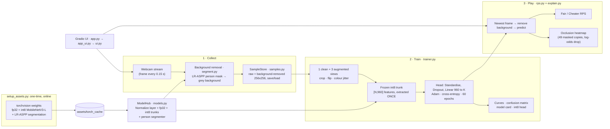

# ✋ Teach Me in 60s

**Teach an AI your hand gestures in under a minute, then play Rock-Paper-Scissors against it.**

You show the webcam ✊ ✋ ✌️ (plus "Nothing", with your hands down), about 25 frames each. A **person-segmentation model removes your background**, so the AI looks at *you* and not the room. The app then **trains a classifier live in about 3 seconds on a laptop CPU**, using transfer learning on a frozen, int8-quantised MobileNetV3. After that you play. In **Fair** mode the AI throws blind and the model only referees. In **Cheater** mode the AI reads your hand in about 14 ms and always plays the winning move. After every round, a **"What the AI looked at"** heatmap shows which part of the frame drove its decision.

Everything runs **offline** after a one-time download.

---

## 1. Setup and run

**Requirements:** Python 3.10–3.12, about 1.5 GB of disk for PyTorch, a webcam, and internet **once** for setup.

```bash
python3 -m venv .venv
source .venv/bin/activate          # Windows: .venv\Scripts\activate
pip install -r requirements.txt
python setup_assets.py             # ONE-TIME, online: downloads ~58 MB of weights into ./assets
python app.py                      # opens http://127.0.0.1:7860
```

> **Updating from an earlier version?** Run `python setup_assets.py` once more while online. It adds the 13 MB segmentation model used for background removal, and `--verify` now checks for all 3 models.

### Night-before checklist (do this on the demo laptop)
1. `python setup_assets.py --verify` should print **All set** (3 weight files).
2. `python app.py --check` runs a headless train → predict → explain test and should print **✓ self-check passed**.
3. `pytest` should report 31 passed.
4. Run the app, record your 4 classes **in the room you will demo in** if possible, then open **🛟 Fallbacks** and press **💾 Save samples**. If the webcam fails in the lab, **📂 Load saved samples** → **Train**, and play using the photo-upload box.
5. Turn Wi-Fi off and run `python app.py` again to prove it works offline.

### Options
```bash
python app.py --no-browser         # don't auto-open a tab
python app.py --port 8000
python app.py --threads 4          # PyTorch CPU threads (default 2 was fastest on our laptop)
```

> **Webcam tips.** Use Chrome or Edge at `http://127.0.0.1:7860`. Browsers only allow the camera on localhost or https. Allow camera access, then press the webcam's own **● Record** button once to start streaming. Our **🎞️ Capture 25 frames** button then grabs frames from that stream. Move your hand around a little while capturing; it makes the model more robust.

---

## 2. How to play

1. **Collect (~20 s).** The classes default to `Rock, Paper, Scissors, Nothing` (editable, up to 5). Pick a class and click **Capture 25 frames** (about 4 s at ~6 frames/s). Do this for each class, ideally 2–3 times each in slightly different positions. For **Nothing**, show yourself with your hands down. The **🎯 What the AI sees** preview under the webcam shows each frame with the background removed: if you can see your hand cut out on grey, you're good.
2. **Train (~3 s).** Keep **🎯 Remove background** ticked, choose augmentations (crop, flip, colour jitter and rotation are on by default) and press **🚀 Train**. You get:
   - loss and accuracy curves (train vs held-out validation),
   - a confusion matrix,
   - a **model card** with tensor shapes, trainable parameters and the fp32 → int8 head size.
   The **🔧 Hyperparameters** drawer exposes backbone (int8/fp32), optimiser, learning rate, epochs, weight decay, dropout, Linear/MLP head, activation, initialisation and feature normalisation.
3. **Play.** Press **✊ ✋ ✌️ SHOOT!**. The banner counts down "Rock… Paper… Scissors…" and then shows **SHOOT!**. **Hold your gesture up in view then.** For up to 2 s the AI watches new webcam frames and waits for a **steady** throw: the same gesture on 3 frames in a row, with the probabilities averaged. Mid-motion frames (fingers still opening) don't count, and a slightly late hand still does. If the webcam stream has stopped, it tells you to press ● Record instead of reusing an old frame.
   - **Fair:** the AI committed to a random move *before* the countdown, and the model is just the referee.
   - **Cheater:** the AI reads your hand and plays the counter-move.
   - If the frame looks like *Nothing*, or the AI is less than 45% sure, it asks you to go again.
   - **🔍 What the AI looked at** shows an occlusion heatmap: red means "hiding this region changed the AI's mind".
   - The banner also shows the AI's **2nd guess**, so near-misses are visible.
   - **Wrong? → "It was ✌️ scissors"** adds the frames of that throw to the right class and **retrains in ~3 s**. The AI learns from its own mistake (human-in-the-loop).

The **Live prediction** panel updates continuously once a model is trained.

---

## 3. Architecture



**Design choices worth mentioning:**
* **Background removal (person segmentation).** With a busy room behind you, a classifier trained on ~25 frames per gesture learns the *room* ("this view = scissors") instead of the hand. That's **shortcut learning**, and it happened in our first real test. LR-ASPP MobileNetV3 keeps only the "person" pixels and paints the rest grey, on training samples, live frames, throws and heatmaps alike, so train and test inputs match. Each sample is cut out once, as it's captured, so training stays fast.
* **Normalisation lives inside the model** (`ImageNetNormalize` layer), so every image is handled as raw `[0, 1]` pixels and preprocessing can't be forgotten or applied twice.
* **Feature caching.** The backbone is frozen, so each (augmented) image goes through it exactly **once**. The head then trains for 60 epochs on cached 960-d vectors in about 0.3 s.
* **int8 backbone by default.** Feature extraction takes 3.0 s with int8 vs 20.9 s with fp32 on our laptop (100 frames → 304 views).
* **Game logic is separate from the UI** (`trainer.py`, `rps.py`, `explain.py` contain no Gradio code), so tests and `--check` run without a browser.
* **Per-player state.** Each browser tab has its own samples, model and scoreboard.

### Project layout
```
app.py              single entry point (launch / --check)
setup_assets.py     one-time weight download + --verify (offline check)
teachme/
  config.py         paths, constants, default classes, offline env vars
  models.py         ModelHub: fp32 + int8 MobileNetV3 trunks, segmenter, normalise layer, size/latency
  segment.py        person segmentation (LR-ASPP) → background removal
  imaging.py        PIL ↔ tensor, square crop, heatmap overlay
  samples.py        SampleStore: raw + background-removed samples (+ save/load), synthetic test gestures
  trainer.py        augmentation, feature caching, head training, metrics, int8 head, plots
  explain.py        occlusion-sensitivity heatmap (log-odds)
  rps.py            Rock-Paper-Scissors rules, Fair / Cheater AI, scoreboard
  ui.py             the game UI (webcam streaming, countdown generator)
  app_ui.py         page assembly + headless self_check()
  about.py          "Under the hood" tab text
  theme.py          theme (local fonts), CSS, banner HTML
tests/              31 pytest smoke tests
```

---

## 4. Features mapped to the syllabus

| Feature | What it demonstrates | Module |
|---|---|---|
| Choosing the classes, incl. **Nothing** | **Task identification**: per-frame *classification*. A closed-set classifier must always pick a class, so we add one for "no gesture" | **M1** Understanding the Vision Problem |
| Frozen pretrained MobileNetV3 + new head | **Classification** with a pretrained backbone; **transfer learning** | **M2** Building Your First Vision Model |
| Model card, Linear vs MLP head | **Tensor shapes** `[N,3,224,224] → [N,960,7,7] → [N,960] → [N,K]`, **parameters** (3 M frozen vs 3,844 trainable for K = 4), MobileNetV3 building blocks | **M3** Neural Network Design |
| Augmentation checkboxes, ×3 copies | **Data augmentation**: 76 training frames become 304 views | **M4** Improving the Data |
| **🎯 Remove background**, "What the AI sees" preview | **Semantic segmentation**: LR-ASPP MobileNetV3 labels every pixel; the "person" mask cuts you out of the room | **M6** Beyond Classification |
| Curves, confusion matrix, optimiser/activation choice | **Cross-entropy loss**, **Adam vs SGD**, **accuracy + confusion matrix** on a held-out split, **ReLU / Hardswish / Tanh / Sigmoid** | **M5** Training Better Models |
| int8 backbone, int8 head, feature caching | **Quantisation** (int8 trunk 5.7 MB vs 22.1 MB, ~7× faster feature extraction), **compute optimisation** | **M7** Efficient Edge AI |
| Normalisation layer, standardisation, weight decay, dropout, init, occlusion map, background removal, steady-throw smoothing | **Image normalisation**, **feature normalisation**, **regularisation**, **weight initialisation** (zeros → symmetry problem), **shortcut learning** found with the occlusion map and fixed with background removal, **temporal smoothing** | **M8** Making Models Robust |

*(8 of 9 modules. M9 generative models are not part of this project.)*

---

## 5. Three-minute live demo script (4 members)

**Before the slot:** the app is open full-screen at 100% zoom. Camera access is already allowed and streaming has started (● Record pressed). A saved sample set exists as backup. Decide who shows which gesture.

| Time | Who | Do | Say (roughly) |
|---|---|---|---|
| 0:00–0:25 | **Member 1** (host) | Show the title banner. | "Can an AI learn a brand-new task from about 100 photos, in a few seconds, on a laptop with no GPU and no internet? We'll teach it Rock-Paper-Scissors live, then play against it. It's an image-classification problem with four classes, including 'Nothing', because a classifier always has to pick *something*." |
| 0:25–1:05 | **Member 2** (data) | Members 3 and 4 hold up ✊, ✋, ✌️ while Member 2 clicks **Capture 25 frames** for each class, then captures **Nothing** (empty frame). Point at the **🎯 What the AI sees** preview and the thumbnails. | "That's 25 frames per class, about 4 seconds each. Look at this preview: a segmentation network cuts us out of the room, so the AI only sees our hands, not the background. During training, augmentation (random crops, flips, rotation and colour jitter) turns these 100 frames into over 300 training views." |
| 1:05–1:45 | **Member 3** (training) | Press **🚀 Train** (about 3 s). Point at the curves, the confusion matrix and the model card. | "Transfer learning: MobileNetV3 was pretrained on 1.2 million ImageNet photos. We freeze its 3 million weights and train only a 3,844-parameter head. The backbone is int8-quantised: 4× smaller and 7× faster, so feature extraction takes 3 seconds instead of 20. Loss drops, validation accuracy goes up, and the confusion matrix is diagonal." |
| 1:45–2:40 | **Member 4** (play) | Invite the professor. One round in **Fair**, then switch to **Cheater** and SHOOT again. Point at **🔍 What the AI looked at**. | "Fair mode: the AI picked its move before the countdown, and the model is only the referee. Now Cheater mode: it reads your hand in about 14 milliseconds, far faster than a human reacts, and plays the counter. And this heatmap shows *why*: we cover parts of the image and see which part, when hidden, makes the AI less sure. If it ever gets one wrong, we press 'It was ✌️': it adds that throw to the training data and retrains in 3 seconds. The AI learns from its mistakes live." |
| 2:40–3:00 | **Member 1** | Open **📚 Under the hood**. | "Every feature maps to a syllabus module: classification, transfer learning, segmentation, augmentation, losses and metrics, quantisation, robustness. That's 8 of the 9 modules, all running offline on this CPU. Thank you!" |

**If something breaks:** webcam is dead → 🛟 Fallbacks → **Load saved samples** → Train → play with "Upload a hand photo". A gesture is misread → capture 25 more frames of it and retrain (3 s), which is a nice live demonstration that more data helps. Slow browser → refresh the tab.

---

## 6. Likely viva questions (with short answers)

1. **Why MobileNetV3-Large?** It is built for mobile CPUs: depthwise-separable convolutions, squeeze-and-excitation and Hardswish give 74% ImageNet top-1 with only 5.5 M parameters and 0.22 GFLOPs. Torchvision also ships an official int8 version.

2. **What is transfer learning, and why freeze the backbone?** We reuse features learned from 1.28 M ImageNet images and train only a new head. With about 100 frames, fine-tuning 3 M weights would overfit and would be slow on a CPU. The frozen trunk turns any frame into a generic 960-d description, and a linear classifier on top is enough to separate our gestures.

3. **How can 25 frames per class be enough?** The pretrained features already separate shapes, textures and colours well, so our classes are nearly *linearly separable* in that 960-d space. Augmentation multiplies the data by 4, and the head has only 3,844 parameters.

4. **Why the "Nothing" class?** Softmax over K classes always sums to 1, so a closed-set classifier must pick *some* gesture even for an empty frame. "Nothing" gives it an honest answer for "no hand", and the referee refuses to call it a throw.

5. **Walk us through the tensor shapes.** `[N,3,224,224]` pixels → normalise → trunk `[N,960,7,7]` → global average pool `[N,960]` → standardise → dropout → Linear 960→K → `[N,K]` logits → softmax. The head has 960·K + K parameters: 3,844 for K = 4.

6. **Which augmentations, and why not vertical flips?** Random resized crop (scale 0.6–1) for position and size, horizontal flip for left vs right hands, colour jitter for lighting. Optional rotation ±15° and blur. Vertical flips would create upside-down hands that never occur in play. Augmentations must reflect real variation.

7. **What is feature caching, and what's the trade-off?** The frozen backbone gives the same output for the same input, so we extract features once (1 clean + 3 augmented views per image) and train on the cache, which is about 60× less backbone work. The trade-off is a fixed set of augmentations instead of fresh random ones every epoch.

8. **What loss and optimiser, and why Adam?** Softmax plus **cross-entropy**, the negative log-probability of the true class. Adam (lr 0.01, weight decay 1e-4) adapts per-parameter step sizes and converges in a few dozen epochs with little tuning. SGD with momentum works too but is more sensitive to the learning rate (try it in the drawer).

9. **How do you know it isn't overfitting?** We hold out 25% of each class as validation (never augmented, never trained on), then compare the train and validation curves and check the confusion matrix. Caveat: the validation set is small (about 6 frames per class), so accuracy is coarse. The real test is live play.

10. **Which regularisation do you use?** A frozen backbone (few trainable parameters), data augmentation, **weight decay** (L2, 1e-4), **dropout** (0.2) before the linear layer, and early-converging training (60 short epochs).

11. **What is feature standardisation, and why use training statistics only?** We subtract the training-set mean and divide by the standard deviation for each of the 960 features, so all features are on a comparable scale and the optimiser behaves better. Using validation data for these statistics would leak information from the held-out set.

12. **Why does an MLP head with zero initialisation stay at chance?** Every hidden unit starts identical, gets identical gradients and stays identical, so symmetry is never broken. With ReLU the hidden outputs are 0, so the first layer's gradients are 0 too. A *single* linear layer can start at zero (no hidden units to break symmetry in), but we default to Kaiming init.

13. **How does int8 quantisation work, and why is it faster?** Weights and activations are stored as 8-bit integers plus per-channel scales and zero-points: 1 byte instead of 4, so about 4× smaller (22.1 → 5.7 MB). Integer kernels (QNNPACK) are cheaper than float math. This model was trained with **quantisation-aware training**, so it loses only about 1% ImageNet accuracy (74.0 → 73.0%). On our CPU, feature extraction is about 7× faster.

14. **How does the "What the AI looked at" heatmap work, and why not Grad-CAM?** It is **occlusion sensitivity**. We cover the frame with a grey 56 px square at 49 positions, re-classify each copy, and colour each region by how much the class's confidence drops. Grad-CAM needs gradients, but the int8 backbone has none, so occlusion explains the *exact* model that played. We measure confidence as **log-odds**, not probability, because a confident model sits at p = 1.0000 where softmax saturates.

15. **What does Cheater mode demonstrate?** Inference speed and confidence. Classifying a frame takes about 14 ms, compared with roughly 200 ms of human reaction time, so an AI that sees your throw always wins *if the classifier is right*. Whenever it loses in Cheater mode, that is a classification error you can point at.

16. **Why remove the background, and how?** In our first real test the AI kept answering "scissors" for a clear rock and a clear paper. The occlusion map was cold on the hand and hot on the room: the model had learned **which room view went with which gesture** (shortcut learning), because the camera angle changed between captures. Validation said 100% because validation frames share those backgrounds. The fix is **semantic segmentation**: LR-ASPP MobileNetV3 (3.2 M parameters, COCO-trained with the Pascal VOC classes) gives every pixel a class, and we keep only "person" pixels. In a background-swap test with our real hands pasted into each other's rooms, accuracy went from **4/9 to 9/9**.

---

## 7. Tests

```bash
pytest                 # 31 smoke tests, ~15 s on CPU (needs setup_assets.py to have run)
python app.py --check  # headless: train on synthetic gestures → predict → explain → segment
```
The tests cover image helpers, the normalise layer, fp32/int8 trunk shapes and similarity, the int8 size reduction, weight quantisation, occlusion maps (including log-odds not saturating), the sample store (save/load), training accuracy and parameter counts, per-class predictions, an occlusion map that is hotter on the "hand" than on the background, the zero-init lesson, RPS rules, the "Nothing" class, the scoreboard, steady-throw smoothing, background removal (masking maths, the real segmenter, raw and background-removed samples kept in sync through save/load, training reusing cut-outs instead of recomputing), and that the Gradio app builds.

## 8. Troubleshooting

| Problem | Fix |
|---|---|
| `MobileNetV3 weights not found in ./assets` | Run `python setup_assets.py` once while online. |
| Webcam shows nothing | Use `http://127.0.0.1:7860` in Chrome or Edge and allow the camera. Press the webcam's **● Record**. Close other apps that use the camera. |
| SHOOT always says "Nothing" | Make sure your hand is **in view when the banner says SHOOT!** (not just when you click). Check that **Live prediction** changes when you show a gesture; if it doesn't, the stream is stopped, so press ● Record under the video. |
| Everything is read as one gesture (e.g. always "scissors") | **Shortcut learning:** the AI learned your *room*, not your hand. Keep **🎯 Remove background** ticked, then **🗑️ Clear all** and re-capture. Keep the camera still, capture each gesture 2–3 times **alternating** (rock, paper, scissors, rock…), and check the occlusion map is red on your hand. |
| **What the AI sees** is all grey | The segmenter didn't find a person. Show more of your arm or body (not just fingertips), use brighter light, and don't hold your hand too close to the lens. |
| ✌️ read as ✋ (or similar mix-ups) | Press **"It was ✌️ scissors"** right after the wrong round, which adds that throw and retrains. Better still, capture each gesture **2–3 times** (each Capture adds 25 frames) at different positions and distances, with your hand **big in the frame**, and include yourself without a gesture in **Nothing**. |
| A gesture keeps being misread | Capture 25 more frames of it (vary angle and distance) and retrain. Check the occlusion map: if it's red on the background, record against a plainer background. |
| Live prediction lags | `python app.py --threads 2` (or 4). Close other heavy apps. |
| Quantised engine error on an unusual CPU | The app automatically falls back to simulated int8 weights. It works, just without the speed-up. |
| Port in use | `python app.py --port 7861` |

*Weights are from torchvision (MobileNetV3-Large, ImageNet-1k). A full explanation of every part of the project is in `PROJECT_EXPLAINED.md`.*
